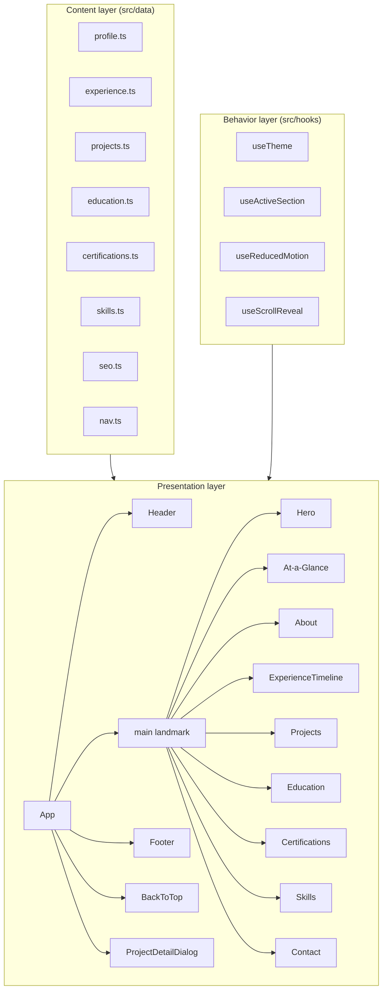
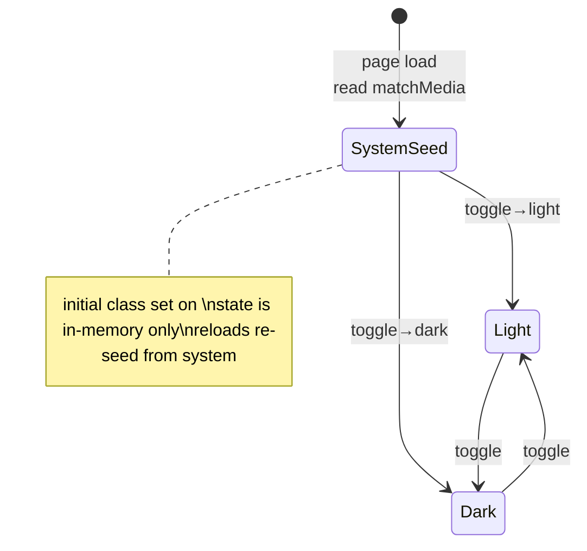
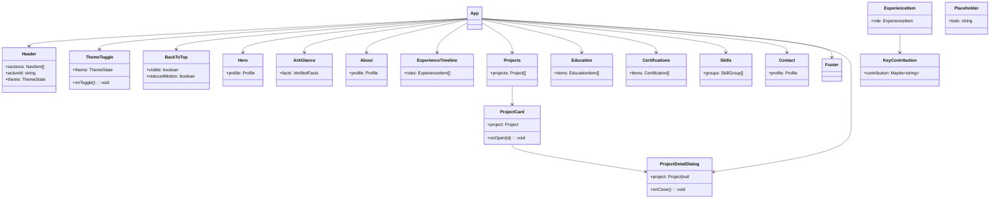

# Design Document

## Introduction

This design describes a modern, responsive, single-page personal portfolio website for Althaf Aprima Ksatria (Business Analyst | Information Systems Management, Jakarta). It is a static site built with Vite + React + TypeScript + Tailwind CSS. There is no backend, no database, no API, no analytics, and no use of `localStorage`/`sessionStorage`. All user-visible text lives in typed data files under `src/data/`, so content can be changed without touching components.

The design directly addresses every requirement and acceptance criterion in `requirements.md`. Research findings that shaped the key decisions are summarized inline and cited.

## Research Summary

Three areas required current best-practice confirmation:

1. **Dark mode without persistence.** Tailwind's class strategy lets a single `dark` class on `<html>` drive all `dark:` variants, while the initial value is seeded from `window.matchMedia('(prefers-color-scheme: dark)')`. This satisfies "follow system preference by default, manual toggle in memory only, never persisted across reloads." ([tryhoverify.com](https://tryhoverify.com/blog/the-art-of-dark-mode-implementation-with-tailwind-css/), [magicui.dev](https://magicui.design/blog/tailwind-dark-mode))

2. **Self-hosted Inter for performance and privacy.** The "no analytics scripts" and Lighthouse 90+ rules preclude the Google Fonts CDN (it makes external requests and is flagged by Lighthouse). Fontsource's variable Inter package (`@fontsource-variable/inter`) bundles the font into the Vite build output, eliminating runtime font requests. ([fontsource.org/docs](https://fontsource.org/docs/getting-started/install), [aaronjbecker.com](https://aaronjbecker.com/posts/fontsource-fontaine-tailwind-vite/))

3. **Accessible project-detail modal.** The native `<dialog>` element (Baseline across browsers since 2022) provides built-in focus management, ESC-to-close, and a backdrop. Combined with `role="dialog"`, `aria-modal="true"`, `aria-labelledby`, focus restoration to the trigger, and `inert` on background content, it meets WCAG 2.1 AA dialog requirements (2.1.1 Keyboard, 2.1.2 No Keyboard Trap). ([openreplay.com](https://blog.openreplay.com/accessible-modals-dialog-vs-library/), [uxpin.com](https://www.uxpin.com/studio/blog/how-to-build-accessible-modals-with-focus-traps/))

## Overview

A static single-page application. A visitor lands on the Hero and, within the initial viewport, sees the Owner's name, title, value sentence, and three action buttons. Directly below the Hero, an At-a-Glance strip of verified facts is followed by About, Experience, Projects, Education/Certifications/Skills, and Contact. A sticky header provides in-page anchor navigation with an active-section indicator; a Back-to-top control appears after scrolling. Light/dark theme follows the system by default with an in-memory manual toggle.

The architecture separates three concerns:

- **Content layer** (`src/data/`): typed TypeScript files holding every user-visible string and structured record. This is the only place non-developers edit content.
- **Presentation layer** (`src/sections/`, `src/components/`): stateless, presentational React components that read from the content layer and render accessible HTML.
- **Behavior layer** (`src/hooks/`, small utilities): theme state, active-section tracking, reduced-motion detection, scroll-reveal, smooth scroll.

No client-side router is used. Navigation is anchor-based with smooth scrolling, which keeps the bundle minimal and the site fully static.

## Architecture

### High-Level Architecture

The site is one `App` component that renders a sticky `Header`, the `main` landmark containing all sections in document order, a `Footer`, a `BackToTop` control, a `ThemeToggle`, and a single `ProjectDetailDialog` rendered at the root (managed by a small modal context). All content flows one way from `src/data/*` into sections; no section mutates content.



### Navigation Approach (Single-Page, Anchor-Based)

- Each section is wrapped in a `<section id="...">` with a stable `Section_Anchor` id (e.g. `#projects`).
- The `Header` renders anchor links pointing to these ids. Clicking a link calls `element.scrollIntoView({ behavior: 'smooth' })`, suppressed to `auto` when `prefers-reduced-motion: reduce` is active.
- `useActiveSection` uses an `IntersectionObserver` on the section elements to set the currently visible section, which drives the header's active indicator.
- `BackToTop` appears once `window.scrollY >= 400` and calls `window.scrollTo({ top: 0 })` (smooth unless reduced motion).
- No history/routing library is introduced; the URL hash may update on click for shareability, but this is optional and must not break deep links.

### Theme System

A three-state model: `system`, `light`, `dark`. The toggle cycles between light and dark; "follow system" is the initial seed only (the toggle does not expose a separate "system" entry, keeping the UX simple — the requirement is a manual toggle with system default, not a three-way UI).

- `useTheme` initializes state from `window.matchMedia('(prefers-color-scheme: dark)').matches`.
- An effect adds/removes the `dark` class on `document.documentElement`.
- The toggle sets explicit `light`/`dark` state. Because state lives only in React (in memory), a page reload re-seeds from the system preference — exactly the required behavior, with no `localStorage`.



### Responsive Layout Strategy

Mobile-first. Tailwind breakpoints are used at three explicit widths named in the requirements:

- `360px` — base (smallest phone). Single column, stacked sections, mobile menu.
- `768px` — `md`. Desktop nav appears; mobile menu hidden; multi-column grids where helpful.
- `1280px` — `xl`. Max content width constrained to keep line length 60–80 characters.

Layout decisions:

- A single centered content column with a `max-width` tuned so prose wraps within 60–80 characters; wider sections (Project grid) use a constrained grid, not full-bleed prose.
- Sections separated by at least `24px` (requirement 7.2), implemented via consistent vertical rhythm using Tailwind spacing scale.
- No horizontal scrolling at any of the three target widths (requirement 7.5): grids collapse to single column, images are constrained with `max-width:100%`, and the 16:9 project images use `aspect-ratio` to prevent overflow.
- The header collapses to a hamburger menu below `768px`.

### Accessibility Architecture

WCAG 2.1 AA is a first-class concern, not an afterthought:

- **Landmarks**: `<header>`, `<nav>`, `<main>`, `<section>` with `aria-labelledby` pointing to each section's heading, `<footer>`.
- **Heading hierarchy**: exactly one `H1` (Hero name). Each section starts with an `H2`; sub-blocks use `H3`. No skipped levels. A lint-time/CI check validates the rendered order.
- **Keyboard**: all interactive elements are real `<a>`/`<button>` controls with visible focus states (Tailwind `focus-visible:` ring using the accent color at sufficient contrast).
- **Color contrast**: the accent color and all text/background pairings are chosen to meet 4.5:1 (normal text) and 3:1 (large text/UI components) in both themes.
- **Images**: every `` has a non-empty `alt` describing purpose. Decorative images use `alt=""`.
- **Reduced motion**: `useReducedMotion` reads `prefers-reduced-motion: reduce`; when active, scroll-reveal animations are disabled and non-essential transitions are removed.
- **Modal**: see ProjectDetailDialog below — native `<dialog>`, focus trap, ESC, focus restoration, `inert` on the rest of the page while open.
- **Forms**: none are rendered (requirement 6.4); a `<form>`-free design avoids a class of a11y pitfalls.

### SEO Implementation

- `index.html` ships `<title>` (≤60 chars), `<meta name="description">` (120–160 chars), Open Graph (`og:title`, `og:description`, `og:image`, `og:type`), Twitter (`twitter:card`, `twitter:title`, `twitter:description`, `twitter:image`), and a `<link rel="icon">`.
- A JSON-LD `<script type="application/ld+json">` block embeds a `Person` schema (name, jobTitle, addressLocality, email, sameAs→LinkedIn, knowsAbout).
- `public/robots.txt` allows all and points to the sitemap.
- `public/sitemap.xml` lists the single canonical URL.
- `<html lang="en">` is set for the English copy.
- Because content lives in typed data, a single `seo.ts` file is the source of truth for title/description/JSON-LD, injected into `index.html` at build time (static values) — no runtime meta mutation needed.

### Performance Strategy

- **Fonts**: self-hosted variable Inter via Fontsource — no external font requests at runtime (supports the "no analytics/scripts" and Lighthouse rules).
- **Images**: served compressed (WebP/AVIF where supported, with PNG/JPG fallback). Below-the-fold images use native `loading="lazy"` and `decoding="async"`; the Hero/above-the-fold image is eager-loaded with `fetchpriority="high"`.
- **16:9 aspect ratio**: CSS `aspect-ratio: 16 / 9` reserves space, eliminating layout shift (CLS) as images load.
- **Code splitting**: the `ProjectDetailDialog` and its case-study content are lazy-loaded (`React.lazy`) so the modal code is not in the initial bundle until a card is opened. Project gallery images in the modal are also lazy.
- **Minimal dependencies**: no UI framework, no router, no animation library (scroll-reveal is a tiny IntersectionObserver hook). This keeps the bundle small for Lighthouse Performance 90+.
- **Build**: Vite produces hashed, minified, tree-shaken assets.

### Build and Deployment

- `npm run dev` — local dev server.
- `npm run build` — `tsc` type-check + `vite build`. Must complete with zero TypeScript errors and produce a static `dist/`.
- `npm run preview` — preview the production build locally.
- Deployable to GitHub Pages, Netlify, or Vercel with a single build command. For GitHub Pages project sites, Vite's `base` is set to the repository name (or a relative `base: './'` is used for portability); this is documented in the README and is a build-time concern only.

## Components and Interfaces

Components are PascalCase; sections live one-per-file under `src/sections/`, reusable primitives under `src/components/`. Each section is a presentational component that imports typed content from `src/data/`.



### Key component contracts

- **Header** (sticky `position: sticky; top: 0`). Renders a `<nav>` of anchor links from `nav.ts`. Highlights the link whose id matches `activeId` (from `useActiveSection`). Below 768px shows a hamburger button that toggles a mobile menu panel (a `Disclosure`-style region with `aria-expanded`).
- **ThemeToggle** — a single `<button aria-label>` with `aria-pressed` reflecting dark state. Calls `useTheme().toggle()`.
- **BackToTop** — a `<button>` revealed via CSS when `scrollY >= 400`. Uses an accessible label (e.g. "Back to top").
- **Hero** — renders name (H1), title, value sentence, and three buttons: "Download CV" (`<a href={cvPath} download>`), "View Projects" (`<a href="#projects">`), "LinkedIn" (`<a href={linkedin} target="_blank" rel="noopener noreferrer">`). If `photo` is absent, renders an initials slot (no ``). If `cvPath`/`linkedin` are unknown, renders a disabled-looking placeholder element with a TODO label instead of a broken `<a>`.
- **AtAGlance** — a strip immediately after Hero (document order guarantees no section between them). Renders exactly the `VerifiedFacts` and nothing else.
- **ExperienceTimeline** — maps `experience.ts` already sorted by role start date descending. Each `ExperienceItem` shows employer, title, location, date range, and accomplishments as a `<ul>`. If `keyContribution` is known, it renders in a separate, visually distinct container (accent-tinted background and/or border) outside the bullet list.
- **ProjectCard** — image-first, `aspect-ratio: 16 / 9`, tool tags as chips. Activates on click, tap, or keyboard (`Enter`/`Space` on a wrapped `<button>`). Calls `openProject(id)`.
- **ProjectDetailDialog** — native `<dialog>` opened via `.showModal()`. Renders all seven `Case_Study_Template` fields; `Process` is a 3–5 step ordered list. Unknown fields render a `Placeholder`. Gallery images each carry a specific caption. BSI projects show blurred/sample dashboard images and the note "Data shown is illustrative / anonymized", and never real names or real internal figures.
- **Education**, **Certifications**, **Skills** — render from their data files. Skills renders five named groups as chips.
- **Contact** — email button (`mailto:`), LinkedIn (new tab), Download CV. No form, no phone.
- **Footer** — copyright only: `© <year> Althaf Aprima Ksatria`.
- **Placeholder** — the single reusable renderer for any `Maybe<T>` value whose `known` is false; displays the `todo` string (which begins with `TODO:`) so gaps are findable by text search.

### Behavior hooks

- **useTheme** — `{ theme, toggle }` as described in the theme system.
- **useActiveSection** — `IntersectionObserver`-based, returns the id of the section most in view.
- **useReducedMotion** — boolean from `matchMedia('(prefers-reduced-motion: reduce)')`.
- **useScrollReveal** — adds a class to reveal elements on scroll; a no-op when reduced motion is active.
- **useModal** — minimal context holding the open project id, with `openProject`/`closeProject`; drives `ProjectDetailDialog`.

## Data Models

All content lives in typed files under `src/data/`. The central type-safety device is a discriminated union that marks any field as known or as a `TODO` placeholder, so components can uniformly render real content or a visible placeholder without inventing data.

```ts
// src/data/types.ts

/** A field that is either a known value or a TODO placeholder.
 *  Unknown values use { known: false, todo: "TODO: <what is missing>" }
 *  so every gap is discoverable by searching the codebase for "TODO:". */
export type Maybe<T> =
  | { known: true; value: T }
  | { known: false; todo: string };

/** Single date (YYYY or YYYY-MM) or a closed/open date range. */
export type DateValue =
  | { kind: "single"; date: string }
  | { kind: "range"; start: string; end: string | "present" };

/** Contact links that may not yet be available (Req 1.6). */
export interface Links {
  linkedIn: Maybe<string>;
  cvPath: Maybe<string>;
}

export interface Profile {
  name: string;
  title: string;                 // "Business Analyst | Information Systems Management"
  valueSentence: Maybe<string>;  // first person, <= 150 chars, evidenced (Req 1.1, 1.4)
  location: string;              // "Jakarta, Indonesia"
  email: string;
  links: Links;
  photo?: string;                // optional; absent => initials placeholder (Req 1.3)
  initials: string;              // used when no photo
}

/** Verified facts only — At_a_Glance renders exactly these (Req 2.2, 2.3). */
export interface VerifiedFacts {
  gpa: string;                   // "3.95"
  designation: string;           // "Summa Cum Laude"
  employeesNormalized: string;   // "~18,000"
  projectCount: number;          // 4
  tools: string[];               // ["Google Data Studio", "Figma", "Google Workspace"]
}

export interface ExperienceItem {
  id: string;
  employer: string;
  jobTitle: string;
  location: string;
  date: DateValue;               // sorted by start date desc (Req 3.1)
  accomplishments: string[];     // bullet points (Req 3.2)
  keyContribution: Maybe<string>;// rendered separately + distinctly (Req 3.3)
}

export interface GalleryImage {
  src: string;
  alt: string;                   // non-empty, describes purpose
  caption: string;              // specific to this image (Req 4.4)
  blurred?: boolean;            // BSI dashboards (Req 4.5)
}

export interface CaseStudy {
  context: Maybe<string>;
  problem: Maybe<string>;
  myRole: Maybe<string>;
  tools: string[];
  process: Maybe<string[]>;      // 3 to 5 steps (Req 4.2)
  outcome: Maybe<string>;
  gallery: GalleryImage[];
}

export interface Project {
  id: string;
  title: string;
  image: string;                 // 16:9 card image, lazy-loaded
  tools: string[];               // tool tags (Req 4.1)
  isBSI: boolean;                 // drives confidentiality handling (Req 4.5)
  caseStudy: CaseStudy;
}

export interface EducationItem {
  id: string;
  institution: string;
  location: string;
  date: DateValue;
  degree: string;
  gpa: Maybe<string>;            // shown only if known (Req 5.2)
}

export interface Certification {
  id: string;
  title: string;
  issuer: string;
  date: DateValue;               // single or range (Req 5.3)
}

export type SkillGroupName =
  | "Business and Data Analysis"
  | "Design and System Modeling"
  | "Tools"
  | "Soft Skills"
  | "Languages";

export interface SkillGroup {
  name: SkillGroupName;
  skills: string[];
}

export interface NavItem {
  id: string;        // Section_Anchor id
  label: string;     // header link text
}

export interface SeoMeta {
  title: string;            // <= 60 chars (Req 7.8)
  description: string;       // 120-160 chars (Req 7.8)
  url: string;
  ogImage: string;
  twitterCard: "summary_large_image";
  jsonLdPerson: object;      // Person schema (Req 7.8)
}
```

### Content files (one record per file, exported as typed constants)

| File | Exports | Drives |
|------|---------|-------|
| `src/data/profile.ts` | `profile: Profile` | Hero, About, Contact |
| `src/data/atAGlance.ts` | `verifiedFacts: VerifiedFacts` | At-a-Glance |
| `src/data/experience.ts` | `experience: ExperienceItem[]` (pre-sorted) | ExperienceTimeline |
| `src/data/projects.ts` | `projects: Project[]` (exactly 4) | Projects, ProjectDetailDialog |
| `src/data/education.ts` | `education: EducationItem[]` | Education |
| `src/data/certifications.ts` | `certifications: Certification[]` | Certifications |
| `src/data/skills.ts` | `skills: SkillGroup[]` (5 groups) | Skills |
| `src/data/nav.ts` | `nav: NavItem[]` | Header anchors |
| `src/data/seo.ts` | `seo: SeoMeta` | index.html + JSON-LD |

### Design decisions and tradeoffs

- **`Maybe<T>` over plain `string | "TODO: ..."`.** A discriminated union gives compile-time exhaustiveness: components must handle the unknown branch, so a placeholder can never be silently omitted. The cost is slightly more verbose content files — an acceptable tradeoff for a site whose core rule is "never invent facts."
- **Native `<dialog>` over a modal library.** Smaller bundle, baseline browser support, built-in a11y. The tradeoff is a little more manual focus management, which is encapsulated in `ProjectDetailDialog`.
- **Class-strategy dark mode over Tailwind's media strategy.** Required to support a manual toggle while defaulting to system preference. The in-memory React state (not `localStorage`) makes persistence-free reloads re-seed from the system, as specified.
- **Fontsource over Google Fonts CDN.** Required by the "no analytics/external scripts" and Lighthouse rules. Slightly larger initial asset, but cached and privacy-respecting.
- **No client router.** Keeps the site static and the bundle minimal; anchor scrolling covers all navigation needs.
- **CV file naming.** The file on disk is `CV_Althaf_Aprima_Ksatria.pdf.pdf` (double extension), but the served path must be `/CV_Althaf_Aprima_Ksatria.pdf` (Req 6.3). The setup step renames the file to a single extension under `public/`; `profile.links.cvPath` is set to `"/CV_Althaf_Aprima_Ksatria.pdf"`.

## Error Handling

- **Unknown content (Req 1.6, 4.3).** Any `Maybe<T>` with `known: false` renders a `Placeholder` showing its `todo` text. This is the primary "graceful absence" path — the site never invents content.
- **Broken/unavailable links (Req 1.6).** A `Links` entry that is unknown renders a disabled placeholder control with a TODO label rather than an `<a>` to a dead URL. The email `mailto:` is treated as required; if it were ever unknown it would follow the same pattern.
- **Missing profile photo (Req 1.3).** `photo` is optional; `Hero` renders an initials slot and no `` when it is absent.
- **Confidential BSI data (Req 4.5).** Projects flagged `isBSI` render dashboard images with `blurred: true` (CSS blur or pre-blurred sample assets) and the note "Data shown is illustrative / anonymized". Real employee names and real internal figures beyond `VerifiedFacts` are never present in the data files, so they can never be rendered.
- **Image load failure.** `onError` on project/hero `` swaps to a neutral placeholder background so a broken image icon does not appear; `alt` still provides context.
- **Build/type errors (Req 7.11).** `npm run build` runs `tsc` first; any type error fails the build. Content files that violate the `Maybe<T>` shape or the "exactly 4 projects" constraint fail at compile time where the data is statically typed (e.g. `projects` typed as a 4-tuple or validated by a build-time assertion).
- **Reduced-motion + JS-disabled.** The site is server-rendered static HTML; content is visible without JS. Animations and the modal are progressive enhancements. With JS disabled, the Project detail could degrade to an in-page anchor target as a fallback (documented as a known limitation; the modal is the primary path).
- **No runtime error boundary swallowing content.** A top-level React error boundary logs to the console and renders a minimal message, but sections are independent enough that a failure in one does not blank the page.

## Testing Strategy

### Property-based testing applicability

This feature is a **static UI-rendering single-page site**. The dominant behaviors are rendering content, layout, accessibility, performance, and SEO — the categories the PBT guidance explicitly excludes (UI rendering/layout, configuration validation, side-effect-only operations). Most acceptance criteria do not vary meaningfully across a generated input space: the Hero always shows the same name, the At-a-Glance always shows the same verified facts, and contact actions are one-shot side effects (open email, open tab, download file).

A small number of behaviors are pure helpers (experience date ordering, value-sentence length, caption specificity), but these are best covered with focused example-based unit tests rather than full property-based testing, because the input space is narrow and concrete. **Property-based testing is therefore not applicable to this feature**, and the Correctness Properties section is intentionally omitted per the workflow.

### Testing stack

| Concern | Tool | Purpose |
|---------|------|---------|
| Unit tests | Vitest + React Testing Library + `@testing-library/jest-dom` | Render components, assert content/behavior |
| Accessibility | `jest-axe` (axe-core) | Automated WCAG checks on rendered output |
| Snapshots | Vitest snapshots | Guard Hero/Header/section markup regressions |
| E2E / responsive | Playwright | Validate 360/768/1280 layouts, no horizontal scroll, modal interactions |
| Performance/SEO/Best Practices | Lighthouse CI | Assert Lighthouse scores >= 90 at 360px mobile |
| Type safety | `tsc --noEmit` | Zero TypeScript errors on build |

### Test coverage by requirement

- **Req 1 (Hero)**: snapshot + unit tests assert name/title/value sentence present in one viewport, value sentence <= 150 chars, three buttons render, initials placeholder when no photo, placeholder control when links unknown.
- **Req 2 (At-a-Glance/About)**: unit test asserts At-a-Glance is the immediate next section after Hero (document order), renders exactly `VerifiedFacts`, no extra metrics; About renders first-person background and the two quick facts.
- **Req 3 (Experience)**: unit test asserts roles are ordered by start date descending, accomplishments are bullets, and `keyContribution` renders in a separate element with a distinct class/background not applied to bullets.
- **Req 4 (Projects)**: unit test asserts exactly four `ProjectCard`s with 16:9 images and tool tags; opening a card (click + keyboard) shows a dialog with all seven case-study fields; unknown fields render a `Placeholder`; `process` has 3–5 steps; BSI projects show the anonymization note and blurred images, with no real names/figures. `jest-axe` checks the dialog a11y.
- **Req 5 (Education/Certifications/Skills)**: unit tests assert each entry's required fields render; GPA only when known; certifications date single or range; skills render five named groups as chips.
- **Req 6 (Contact/CV)**: unit tests assert `mailto:` recipient, LinkedIn `target="_blank"` + `rel="noopener noreferrer"`, CV `download`; assert no `<form>` and no phone number anywhere; footer copyright format.
- **Req 7 (Quality)**: 
  - Unit/integration: sticky header anchors exist, active indicator updates via mocked `IntersectionObserver`, mobile menu collapses below 768px, Back-to-top visible after 400px scroll.
  - Unit: heading order has one H1 and no skipped levels (DOM query); value sentence and SEO title/description length bounds; line-length container widths.
  - Theme: `useTheme` seeds from `matchMedia`, toggling adds/removes `dark` class, no `localStorage`/`sessionStorage` calls anywhere (a test greps the bundle/source).
  - Reduced motion: scroll-reveal is disabled and transitions removed when the media query matches.
  - Playwright: no horizontal scroll and no overlap at 360/768/1280.
  - Lighthouse CI: Performance, Accessibility, Best Practices, SEO each >= 90 at 360px.
  - Build: `npm run build` exits 0 with zero `tsc` errors; no console errors on load/navigation (Playwright console assertion).

### Unit-testing balance

Per the workflow guidance, unit tests focus on specific examples, edge cases (empty TODO fields, no photo, unknown links, BSI blurring), and component integration points. Snapshot tests guard the stable presentational markup. Heavy randomized/property-based testing is intentionally not used here because the feature's behavior does not vary across a large generated input space.

### README (Req 7.10)

The README documents: editing content via `src/data/*`, adding project images under `src/assets/` (and `public/` for CV/favicon/social), replacing the CV file (with the single-extension naming rule), local dev/build/preview commands, deployment to GitHub Pages/Netlify/Vercel, and a generated or hand-maintained table enumerating every remaining `TODO:` placeholder and its file location.
